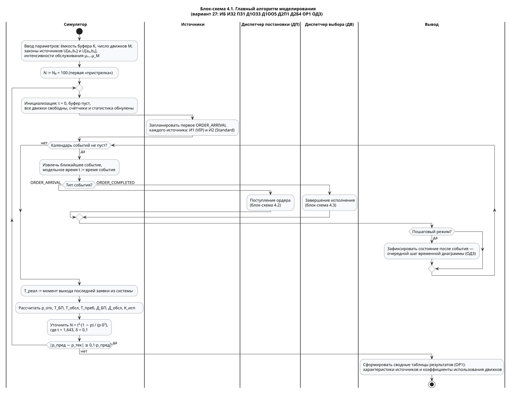
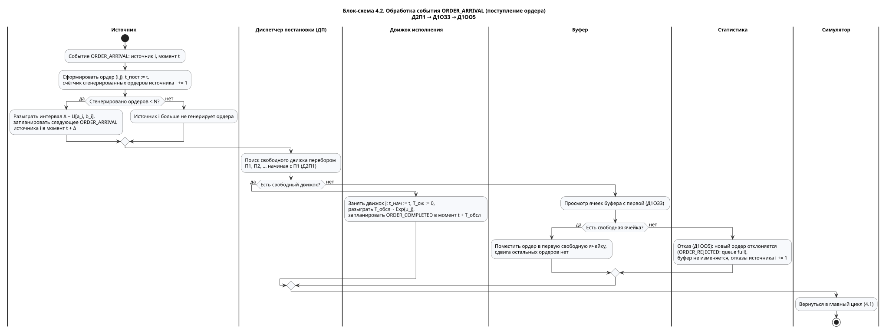
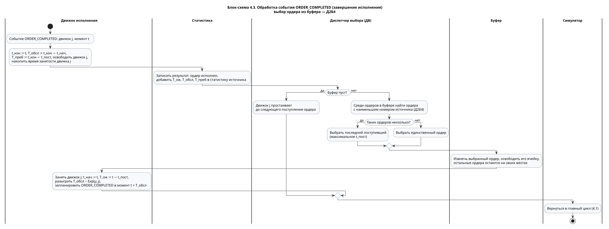
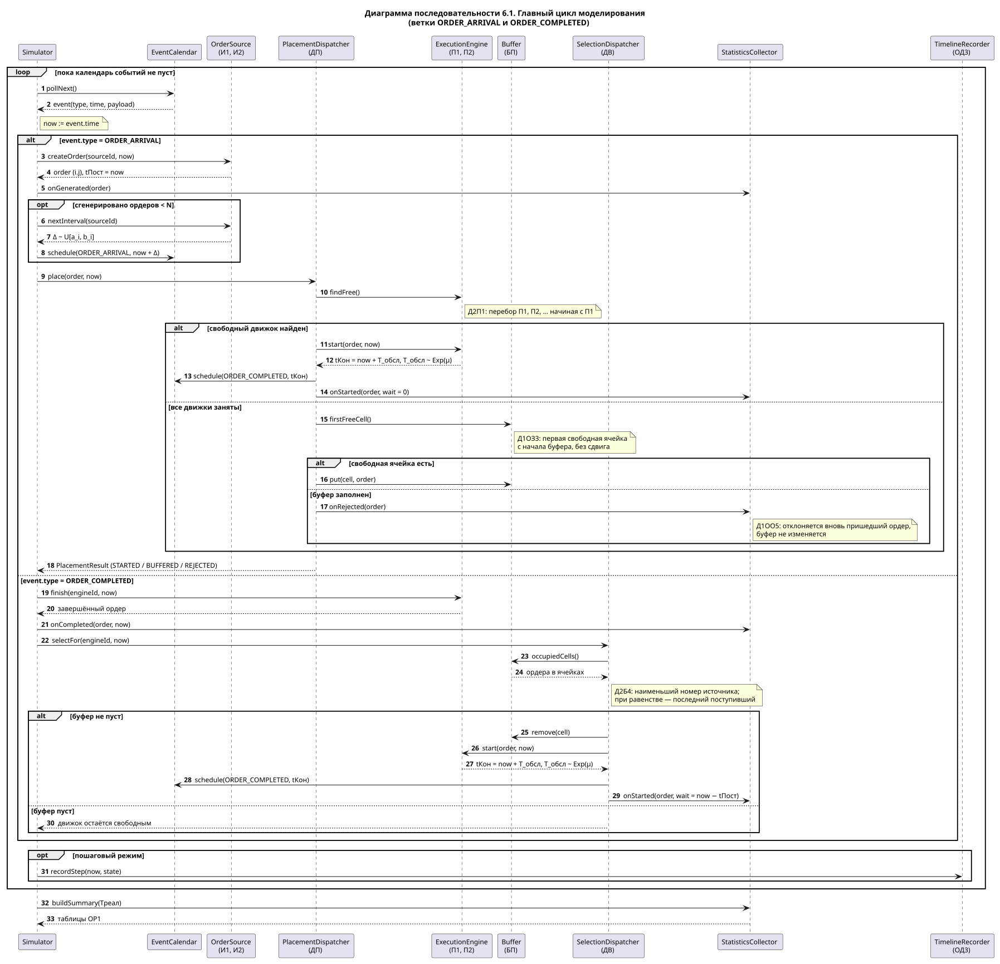
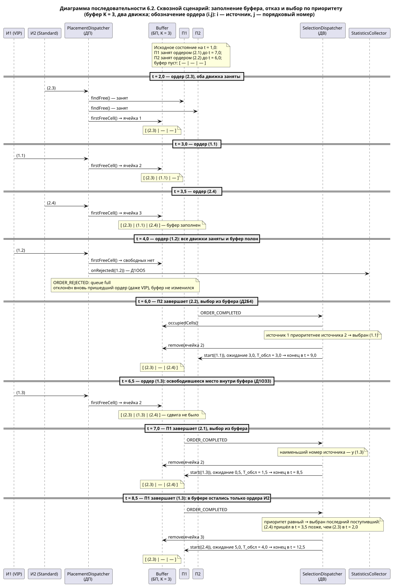
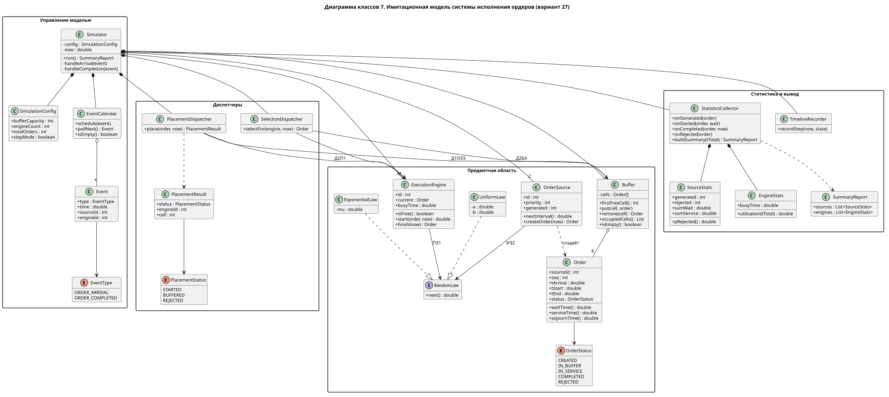

# Первичные артефакты — Система исполнения ордеров криптовалютной биржи

**Студент:** Лукин Илья Алексеевич, группа 5130904/40101
**Дисциплина:** Архитектура вычислительных систем, курсовая работа «Создание имитационной модели вычислительной системы»
**Вариант:** № 27
**Бизнес-домен:** криптовалютная биржа — система исполнения ордеров

---

## Содержание

1. [Описание проекта](#1-описание-проекта)
2. [Формула варианта и расшифровка](#2-формула-варианта-и-расшифровка)
3. [Компоненты и принципы моделирования](#3-компоненты-и-принципы-моделирования)
4. [Блок-схемы](#4-блок-схемы)
5. [Правила работы и граничные случаи](#5-правила-работы-и-граничные-случаи)
6. [Диаграммы последовательности](#6-диаграммы-последовательности)
7. [Диаграмма классов](#7-диаграмма-классов)
8. [Дальнейшие шаги](#8-дальнейшие-шаги)

---

## 1. Описание проекта

Система исполнения ордеров криптовалютной биржи моделируется как система массового обслуживания (СМО). Трейдеры двух категорий — **VIP** (источник № 1, высший приоритет) и **Standard** (источник № 2) — подают ордера на покупку и продажу криптовалюты. Ордера обслуживаются **движками исполнения** (приборами): П1 — основной, П2 — резервный.

Если в момент поступления ордера все движки заняты, ордер помещается в **буфер** ограниченной ёмкости *K*. Если места нет и в буфере, вновь пришедший ордер отклоняется (отказ). Когда движок освобождается, из буфера выбирается ордер трейдера с наивысшим приоритетом: VIP-ордера всегда исполняются раньше Standard.

Подробное описание предметной области и сопоставление элементов СМО сущностям биржи приведены в документах [«Бизнес-домен»](business-domain.md) и [«Маппинг элементов СМО на сущности бизнес-домена»](mapping.md).

---

## 2. Формула варианта и расшифровка

```
ИБ  ИЗ2  ПЗ1  Д1ОЗ3  Д1ОО5  Д2П1  Д2Б4  ОР1  ОД3
```

| Код | Компонент | Значение | Интерпретация в бизнес-домене |
|---|---|---|---|
| **ИБ** | Источник | Бесконечный | Трейдеры не заканчиваются: после подачи ордера источник продолжает генерировать следующие в течение всей торговой сессии |
| **ИЗ2** | Закон генерации | Равномерный | Интервал между ордерами источника *i* — случайная величина U[a_i, b_i] |
| **ПЗ1** | Закон обслуживания | Экспоненциальный | Время исполнения ордера движком ~ Exp(μ_j) |
| **Д1ОЗ3** | Буферизация | На свободное место | Ордер занимает первую свободную ячейку буфера, считая с начала; сдвига остальных ордеров нет |
| **Д1ОО5** | Отказ | Вновь пришедшая заявка | При полном буфере отклоняется новый ордер, содержимое буфера не меняется |
| **Д2П1** | Выбор прибора | Приоритет по номеру | Свободный движок ищется перебором, всегда начиная с П1 |
| **Д2Б4** | Выбор заявки | Приоритет по номеру источника, по одной заявке | Из буфера берётся ордер с наименьшим номером источника (VIP раньше Standard); среди ордеров одного источника — последний поступивший |
| **ОР1** | Автоматический режим | Сводная таблица | После моделирования выводятся таблицы характеристик источников и приборов |
| **ОД3** | Пошаговый режим | Временные диаграммы | Шаг — от одного особого события до ближайшего следующего; состояние отображается на временной диаграмме |

---

## 3. Компоненты и принципы моделирования

Модель строится по **принципу особых событий** (дискретно-событийное моделирование). В базовой конфигурации два источника и два движка; ёмкость буфера *K*, параметры законов U[a_i, b_i], интенсивности μ_j и число ордеров *N* задаются пользователем.

Особые события:

- `ORDER_ARRIVAL` — поступление ордера от источника;
- `ORDER_COMPLETED` — завершение исполнения ордера движком.

| Компонент | Класс | Назначение |
|---|---|---|
| Моделирующий алгоритм | `Simulator` | Главный цикл: извлекает ближайшее событие, продвигает модельное время, вызывает обработчики |
| Календарь событий | `EventCalendar` | Хранит запланированные события, выдаёт ближайшее по времени |
| Источники И1, И2 | `OrderSource` | Генерируют ордера; интервал между ордерами разыгрывается по U[a_i, b_i] (ИЗ2) |
| Диспетчер постановки (ДП) | `PlacementDispatcher` | Алгоритм: выбирает движок (Д2П1), ставит ордер в буфер (Д1ОЗ3) или отклоняет его (Д1ОО5) |
| Диспетчер выбора (ДВ) | `SelectionDispatcher` | Алгоритм: при освобождении движка выбирает ордер из буфера (Д2Б4) |
| Буферная память (БП) | `Buffer` | *K* ячеек для ожидающих ордеров |
| Приборы П1, П2 | `ExecutionEngine` | Исполняют ордера; время обслуживания ~ Exp(μ_j) (ПЗ1) |
| Сбор статистики | `StatisticsCollector` | Накапливает данные для таблиц ОР1 |

> **Диспетчеры — алгоритмы, а не люди.** ДП и ДВ — программные модули системы матчинга: они работают автоматически, а время их работы в модели принимается равным нулю.

---

## 4. Блок-схемы

Блок-схемы оформлены как UML-диаграммы активностей с дорожками (swimlanes). Исходники PlantUML лежат рядом с SVG.

### 4.1 Главный алгоритм

[](diagrams/flowchart_main.svg)

[SVG](diagrams/flowchart_main.svg) · [PlantUML](diagrams/flowchart_main.puml)

Внешний цикл реализует автоматический подбор числа ордеров *N* для заданной точности: первая «пристрелка» при N₀ = 100, затем уточнение по формуле N = t²·(1 − p) / (p·δ²), где t = 1,643 (доверительная вероятность 0,9), δ = 0,1 (относительная точность 10 %). Прогоны повторяются, пока |p_пред − p_тек| ≥ 0,1·p_пред.

### 4.2 Поступление ордера

[](diagrams/flowchart_arrival.svg)

[SVG](diagrams/flowchart_arrival.svg) · [PlantUML](diagrams/flowchart_arrival.puml)

### 4.3 Завершение исполнения

[](diagrams/flowchart_completion.svg)

[SVG](diagrams/flowchart_completion.svg) · [PlantUML](diagrams/flowchart_completion.puml)

---

## 5. Правила работы и граничные случаи

1. **Д1ОЗ3.** Поиск свободной ячейки всегда идёт с первой ячейки буфера. Указателя нет, ордера не сдвигаются. После извлечения ордера из середины буфера в нём образуется «дырка», и следующий поступивший ордер займёт именно её (пример — сценарий 6.2, момент t = 6,5).
2. **Д1ОО5.** Отказ возможен, только если заняты все движки и все ячейки буфера. Отклоняется вновь пришедший ордер **любой категории, включая VIP**; буфер не изменяется, ордер возвращается трейдеру с кодом `ORDER_REJECTED: queue full`. Отклонённый ордер **учитывается** в числе сгенерированных ордеров своего источника.
3. **Д2Б4.** Берётся ордер с наименьшим номером источника. Если таких несколько, выбирается **последний поступивший** (с максимальным t_пост), а не самый старый.
4. **Д2П1.** Перебор движков начинается с П1 при каждом назначении. Освободившийся движок сам берёт следующий ордер из буфера; перебор в этом случае не нужен.
5. **Пустой буфер.** Если при завершении исполнения буфер пуст, движок простаивает до следующего поступления ордера.
6. **Одновременные события.** Принято соглашение: при совпадении времени событий сначала обрабатывается `ORDER_COMPLETED`, затем `ORDER_ARRIVAL`.
7. **Завершение моделирования.** Генерация прекращается, когда сгенерировано *N* ордеров. Обслуживание продолжается до выхода из системы последнего ордера; этот момент — общее время реализации T_реал.
8. **Статистика.** Для каждого ордера фиксируются t_пост, t_нач, t_кон; T_ож = t_нач − t_пост, T_обсл = t_кон − t_нач, T_преб = t_кон − t_пост = T_ож + T_обсл. Времена считаются по исполненным ордерам; отклонённые учитываются только в p_отк.

**Выходные характеристики (ОР1).**

| Таблица | Содержимое |
|---|---|
| Характеристики источников | По каждому источнику: количество ордеров, p_отк = m / n, T_преб, T_БП (ожидание), T_обсл, Д_БП (дисперсия времени ожидания), Д_обсл (дисперсия времени обслуживания) |
| Характеристики приборов | По каждому движку: K_исп = суммарное время занятости / T_реал |

**Временная диаграмма (ОД3)** показывает по оси времени: моменты поступления ордеров каждого источника, периоды ожидания в буфере, заполнение ячеек буфера, периоды занятости П1 и П2, моменты отказов.

---

## 6. Диаграммы последовательности

### 6.1 Главный цикл

[](diagrams/sequence_main.svg)

[SVG](diagrams/sequence_main.svg) · [PlantUML](diagrams/sequence_main.puml)

### 6.2 Сквозной сценарий: заполнение буфера, отказ, выбор по приоритету

[](diagrams/sequence_overflow.svg)

[SVG](diagrams/sequence_overflow.svg) · [PlantUML](diagrams/sequence_overflow.puml)

Сценарий: *K* = 3, два движка. Ордер (i.j) — j-й ордер источника i; времена обслуживания заданы заранее.

| t | Событие | Действие системы | Буфер после события |
|---|---|---|---|
| 0,0 | приходит (2.1) | оба движка свободны → П1 (Д2П1), конец в 7,0 | [ — \| — \| — ] |
| 1,0 | приходит (2.2) | П1 занят → П2, конец в 6,0 | [ — \| — \| — ] |
| 2,0 | приходит (2.3) | движки заняты → ячейка 1 | [ (2.3) \| — \| — ] |
| 3,0 | приходит (1.1) | → ячейка 2 | [ (2.3) \| (1.1) \| — ] |
| 3,5 | приходит (2.4) | → ячейка 3, буфер полон | [ (2.3) \| (1.1) \| (2.4) ] |
| 4,0 | приходит (1.2) | **отказ (Д1ОО5)**, буфер не меняется | [ (2.3) \| (1.1) \| (2.4) ] |
| 6,0 | П2 завершает (2.2) | Д2Б4: источник 1 приоритетнее → (1.1) на П2, ожидание 3,0, конец в 9,0 | [ (2.3) \| — \| (2.4) ] |
| 6,5 | приходит (1.3) | Д1ОЗ3: первая свободная — ячейка 2, сдвига нет | [ (2.3) \| (1.3) \| (2.4) ] |
| 7,0 | П1 завершает (2.1) | Д2Б4: → (1.3) на П1, ожидание 0,5, конец в 8,5 | [ (2.3) \| — \| (2.4) ] |
| 8,5 | П1 завершает (1.3) | в буфере только И2: последний поступивший — (2.4), ожидание 5,0, конец в 12,5 | [ (2.3) \| — \| — ] |
| 9,0 | П2 завершает (1.1) | → (2.3) на П2, ожидание 7,0, конец в 11,5 | [ — \| — \| — ] |
| 12,0 | приходит (1.4) | П1 занят до 12,5 → П2, конец в 13,0 | [ — \| — \| — ] |

Итоги сценария (эталон для самопроверки программы), T_реал = 13,0:

| Источник | Сгенерировано | Отказов | p_отк | T_БП | T_обсл | T_преб |
|---|---|---|---|---|---|---|
| И1 (VIP) | 4 | 1 | 0,25 | 1,167 | 1,833 | 3,000 |
| И2 (Standard) | 4 | 0 | 0 | 3,000 | 4,625 | 7,625 |

| Прибор | Время занятости | K_исп |
|---|---|---|
| П1 | 12,5 | 0,962 |
| П2 | 11,5 | 0,885 |

---

## 7. Диаграмма классов

[](diagrams/class_diagram.svg)

[SVG](diagrams/class_diagram.svg) · [PlantUML](diagrams/class_diagram.puml)

### 7.1 Группы классов

| Группа | Классы |
|---|---|
| Управление моделью | `Simulator`, `SimulationConfig`, `EventCalendar`, `Event`, `EventType` |
| Предметная область | `Order`, `OrderStatus`, `OrderSource`, `Buffer`, `ExecutionEngine`, `RandomLaw`, `UniformLaw`, `ExponentialLaw` |
| Диспетчеры | `PlacementDispatcher`, `SelectionDispatcher`, `PlacementResult`, `PlacementStatus` |
| Статистика и вывод | `StatisticsCollector`, `SourceStats`, `EngineStats`, `TimelineRecorder`, `SummaryReport` |

### 7.2 Примечания

- **Буфер инкапсулирует ячейки.** Диспетчеры работают через `firstFreeCell()`, `put()`, `remove()`, `occupiedCells()`, не обращаясь к массиву напрямую.
- **Диспетчеры разделены.** `PlacementDispatcher` отвечает за Д2П1, Д1ОЗ3, Д1ОО5; `SelectionDispatcher` — за Д2Б4.
- **Законы распределения вынесены в `RandomLaw`.** ИЗ2 — `UniformLaw`, ПЗ1 — `ExponentialLaw`; это упрощает тестирование с фиксированными значениями (например, сценарий 6.2).
- **Результат постановки** возвращается объектом `PlacementResult` со статусом `STARTED`, `BUFFERED` или `REJECTED`.
- **Режимы вывода:** ОД3 реализует `TimelineRecorder`, ОР1 — `SummaryReport`, который собирает `StatisticsCollector`.

---

## 8. Дальнейшие шаги

- [ ] Согласовать сигнатуры методов на диаграммах последовательности и классов.
- [ ] Проверить, что каждое изменение статуса ордера (`CREATED → IN_BUFFER → IN_SERVICE → COMPLETED`, `CREATED → REJECTED`) отражено в статистике.
- [ ] Реализовать сценарий 6.2 как модульный тест с фиксированными значениями случайных величин.
- [ ] Проверить, что ссылки и имена файлов в `docs/diagrams/` совпадают с этим документом.
- [ ] Начать реализацию программы и подготовить отчёт.
